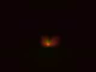

# universe

An interactive 2D wave-field experiment in Rust. Click to superpose a pair of
oppositely wound disturbances, watch their evolution, and hold keys to inspect
density, phase winding, core strength or momentum. The periodic grid, numerical
coefficients and update equations are preserved from `main`; `stage3` is a
separate experimental direction.



This is a **headless capture**, using the same pixel conversion as the window:
160×120, one positive-orientation pair at `(80, 60)`, after 40 steps. It is not a
screenshot of a verified GUI session. The dark background and small bright
structure reflect the existing display thresholds.

## Build and run

Install Rust/Cargo and a native C toolchain. The GUI uses the locked `minifb`
0.27 dependency and requires a working X11 or Wayland desktop on Linux. The
[upstream 0.27 build notes](https://docs.rs/crate/minifb/0.27.0) list these
Debian/Ubuntu dependencies (package installation was not performed during review):

```sh
sudo apt install build-essential pkg-config libxkbcommon-dev libwayland-cursor0 libwayland-dev
```

Then, from the repository root:

```sh
cargo build --release --locked
cargo run --release --locked --bin universe
```

The initial window is mostly black until a pair is spawned. The grid is 400×400,
with one simulation step per display update and a target of 60 updates/second;
this is not a fixed physical time scale or a measured frame-rate guarantee.

| Input | Behavior |
| --- | --- |
| Left click | Spawn positive orientation: left/right cores use `+atan2` / `-atan2` |
| Right click | Reverse both windings: left/right cores use `-atan2` / `+atan2` |
| Shift + left/right click | Push nearby cells with density >0.15 toward right/left |
| Hold H | Randomly perturb U/V in cells with density >0.1 (not reproducible) |
| Hold T | Run 100 steps per display update; title statistics pause |
| Hold P | Potential/density view with a low-brightness floor |
| Hold C | Signed winding diagnostic: positive red, negative blue |
| Hold X | Core-strength diagnostic in grayscale |
| Hold F | Momentum-magnitude diagnostic in red |
| Space | Reset all fields and previous-step history |
| Escape or close window | Exit |

Clicks trigger once per press; release both mouse buttons before spawning again.
Diagnostic priority is X, F, C, P. Positive/negative orientation names refer to
phase winding, not electric charge or net pair charge. Screen Y points downward;
the charge diagnostic walks upward around a cell, so its sign convention differs
from the screen-coordinate angle. Both orientations retain the existing phase
offset and initial time shift; this change does not claim opposite velocities.

## Headless checks and captures

```sh
cargo test --locked --no-default-features
cargo run --release --locked --no-default-features --example capture -- output/capture
```

The core has no GUI or random-number dependency. `--no-default-features` excludes
them from compilation. After dependencies/index metadata are cached, add
`--offline` to the commands above. The capture command writes five PPM images:
`matter`, `potential`, `charge`, `core` and `momentum`; use a PPM-capable viewer.
It writes only generated data to the chosen output directory.

Eight tests cover periodic indexing and spawn centers (including signed integer
extremes), independently calculated uniform-field
density decay, signed charge recomputation, full reset, reversed current and
previous spawn orientation, positive dimensions, and a deterministic 200-step
run with finite fields and all five diagnostic buffers. The repeated run is
compared exactly on the same executable; cross-platform bit identity is not
promised. Tests do not establish long-term stability or physical validity.

Verified on 2026-11-06 with Linux x86-64, Rust/Cargo 1.94.0:

- `cargo test --locked --offline --no-default-features`: **8 passed**.
- `cargo build --release --locked --offline`: **passed**, including the GUI.
- The headless capture command: five 160×120 frames generated and visually
  inspected; repeated captures matched byte for byte.
- `cargo fmt --check` and `git diff --check`: passed.

**Graphical checks remain unverified.** Launching the built executable in the
review environment failed with `XOpenDisplay failed`; the compositor socket was
also inaccessible. The application reports a clear error and exits nonzero.
Mouse/keyboard input, actual window presentation and Windows/macOS behavior still
need a desktop smoke check using the controls above.

## Experimental limits

These are heuristic dynamics and diagnostics, not validated physics. Names such
as “charge”, “matter”, “potential” and “momentum” describe internal fields; they
do not establish conservation laws, units, particle models or correspondence to
real phenomena. Charge near zero-amplitude points is ambiguous, peak separation
in the title does not correct for periodic seams, and dense/multiple spawns,
random heating or long runs can behave differently from the bounded tests.

The application uses CPU loops, allocates next-step buffers each step and does
extra diagnostic scans periodically. Warp mode can make the window sluggish.
The equations and performance architecture have deliberately not been redesigned.
